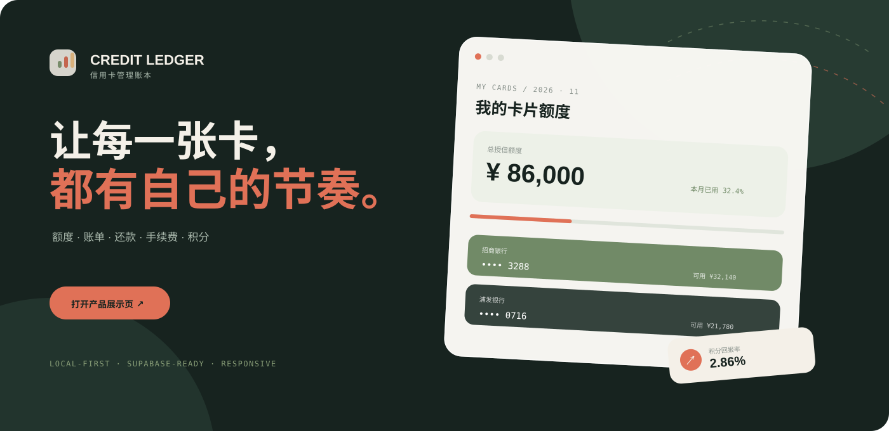

<div align="center">
  <a href="https://credit-card-ledger.vercel.app/landing.html">
    
  </a>
  <a href="https://credit-card-ledger.vercel.app/index.html">
    
  </a>
</div>

<br />

<div align="center">
  <h1>Credit Ledger</h1>
  <p><strong>信用卡管理账本</strong></p>
  <p>让每一张卡，都有自己的节奏。</p>
  <p>额度、账单、还款、手续费和积分，放进一个清楚的系统里。</p>
</div>

<p align="center">
  <a href="https://credit-card-ledger.vercel.app/landing.html">产品展示页</a>
  ·
  <a href="https://credit-card-ledger.vercel.app/index.html">在线账本</a>
  ·
  <a href="https://github.com/ajinggo/credit-card-ledger/issues">反馈问题</a>
</p>

<p align="center">
  
  
  
  
</p>

<br />

> 一个面向个人信用卡管理的纯前端账本。
> 先把信息留在本机，再按需要开启 Supabase 云同步；不依赖构建工具，打开浏览器就能开始。

## 先看一眼

<div align="center">
  <a href="https://credit-card-ledger.vercel.app/landing.html">
    
  </a>
  <br />
  <sub>点击封面进入产品展示页；点击页面里的「打开账本」进入实际应用。</sub>
</div>

## 先从这里开始

| 想做什么 | 入口 |
| --- | --- |
| 先了解产品 | [打开产品展示页](https://credit-card-ledger.vercel.app/landing.html) |
| 直接开始记录 | [打开在线账本](https://credit-card-ledger.vercel.app/index.html) |
| 在本地运行 | `python3 -m http.server 8768` |
| 查看数据结构 | [`supabase/schema.sql`](./supabase/schema.sql) |

## 它解决什么

信用卡一多，真正难的不是记录一笔消费，而是同时记住额度归属、账单周期、还款进度、临时额度、年费任务和积分有效期。Credit Ledger 把这些信息放到同一套时间和金额口径里，让你每次打开都能快速回答：

- 这个月实际用了多少额度？
- 哪张卡什么时候要还？还了多少，还差多少？
- 多张共享额度的卡，整体还剩多少可用额度？
- 手续费、积分价值和净收益到底是多少？
- 哪些积分、临额或年费任务快到期？

## 核心能力

<div align="center">

| 01 · 卡片 | 02 · 账单 | 03 · 分析 | 04 · 同步 |
| --- | --- | --- | --- |
| 额度、共享额度、账单日、还款日 | 出账、最低还款、部分还款、逾期 | 手续费、积分价值、净收益、趋势 | 本地备份、邮箱登录、多设备同步 |

</div>

| 模块 | 能做什么 |
| --- | --- |
| **我的卡片额度** | 记录固定额度、临时额度、可用额度、账单日和还款日 |
| **共享额度账户** | 同一银行的多张卡共用一个额度池，总授信只计算一次 |
| **月度账单与还款** | 追踪账单金额、最低还款、实际还款、部分还款和逾期状态 |
| **手续费汇总** | 记录套现、渠道、费率、手续费、积分价值和净收益 |
| **消费看板** | 查看年度消费、月度消费、额度使用率和临额到期提醒 |
| **积分账户** | 管理航空里程、酒店积分、余额、账号、到期日和滚动有效期 |
| **待办中心** | 汇总账单日、还款日、临额、积分和年费任务 |
| **数据工具** | 一键导出或导入完整 JSON 备份 |
| **云端账号** | 邮箱登录、会话恢复、多设备读取与上传账本快照 |

## 设计取向

- **本地优先**：未登录时，数据只保存在当前浏览器的 `localStorage`。
- **需要时再同步**：登录 Supabase 后，才会读取或上传云端账本快照。
- **少录敏感信息**：建议只保存银行名称和卡片尾号，不保存完整卡号、CVV、交易密码或身份证信息。
- **清楚的金额口径**：账单消费已经包含套现金额，套现只作为分析子项，不会被重复计入年度消费和额度使用。
- **可随时备份**：JSON 导出和导入独立于云同步，方便迁移和恢复。

## 共享额度的计算方式

同一银行的多张信用卡可以选择同一个额度账户。例如两张浦发卡共用 ¥50,000 额度：

```text
总授信额度 = ¥50,000（只计算一次）
共享额度已用 = 两张卡当月账单金额之和
共享额度可用 = 额度账户总额 - 两张卡当月账单金额之和
```

每张卡仍然独立保存账单日、还款日、年费政策、月度账单、还款状态和手续费记录。

## 运行项目

项目没有 Node.js 构建步骤，可以直接打开页面：

```bash
git clone https://github.com/ajinggo/credit-card-ledger.git
cd credit-card-ledger
open index.html
```

需要本地 HTTP 服务时：

```bash
python3 -m http.server 8768
```

然后打开：

- 产品展示页：<http://127.0.0.1:8768/landing.html>
- 账本应用：<http://127.0.0.1:8768/>

## 项目结构

```text
.
├── index.html                 # 账本应用页面与表单
├── landing.html               # GitHub / Vercel 产品展示页
├── landing.css                # 展示页视觉系统与响应式样式
├── docs/assets/credit-ledger-readme.svg # README 封面视觉
├── app.js                     # 数据、计算和交互逻辑
├── credit-account-model.js    # 共享额度迁移与计算模型
├── card-sort-model.js         # 卡片排序模型
├── fee-visibility-model.js    # 手续费指标显示模型
├── styles.css                 # 基础样式
├── organic-liquid.css         # 账本视觉系统与移动端样式
├── cloud-sync.js              # Supabase 登录与云同步
├── supabase-config.js         # Supabase 公开客户端配置
├── supabase/schema.sql        # 数据表、授权与 RLS 策略
├── tests/                     # 共享额度、布局和交互回归测试
└── vercel.json                # 根路径重写到产品展示页
```

## Supabase 配置

部署到其他 Supabase 项目时：

1. 创建项目并启用 Email / Password 登录。
2. 在 SQL Editor 执行 [`supabase/schema.sql`](./supabase/schema.sql)。
3. 在 Authentication URL Configuration 中加入生产地址和本地开发地址。
4. 将 Project URL 和 Publishable Key 填入 [`supabase-config.js`](./supabase-config.js)。
5. 不要在前端写入 `service_role`、secret key 或数据库密码。

`ledger_state` 表为每个用户保存一份 JSONB 账本快照，并通过 `auth.uid() = user_id` 限制用户只能访问自己的数据。

## 开发检查

```bash
node --test tests/credit-account-model.test.cjs
node --test tests/mobile-responsive-layout.test.mjs
node tests/toast-layout.test.mjs
node --check app.js
node --check cloud-sync.js
git diff --check
```

## 发布

根路径已经通过 [`vercel.json`](./vercel.json) 指向产品展示页；展示页中的按钮会进入 `index.html` 账本应用。

```bash
npx vercel --prod
```

线上地址：

- 产品展示页：<https://credit-card-ledger.vercel.app/landing.html>
- 账本应用：<https://credit-card-ledger.vercel.app/index.html>

## 许可

本仓库当前未附带开源许可证。未经明确授权，不代表允许复制、修改或再分发。
